# Trabajo de Fin de Ciclo - ReparaTuCoche
En este **README** quiero centrarme en la parte tecnica del proyecto, pero el trabajo tambien consiste en desarrollar una empresa. Para poder ver completo el trabajo, con la parte de empresa y la parte tecnica, en formato de presentacion o de PDF se encuentra en la carpeta **PDF** (Documentacion completa), **Presentacion** (PowerPoint de exposicion), **BBDD** (Estructura BBDD) y **estructura_pagina_web** (HTML, CSS, JAVA, imagenes y videos de la pagina web).

## Indice
1. Introduccion
2. Tecnologias
3. Arquitectura
4. Balanceador de cargas
5. DNS
6. SFTP
7. NFS
8. Base de Datos y MySQL
9. Apache
10. Pagina web
11. PHP
12. Conclusiones

## 1.- Introduccion
En el Trabajo de Fin de Ciclo he decidido desarrollar una plataforma web funcional basada en un cluster de servidores. El objetivo es diseniar, configurar e implementar tecnologias como en un entorno empresarial. Para ello he pensado en la idea de que sea una una plataforma que garantice alta disponibilidad, escalabilidad, seguridad y balanceo de cargas<br>

El nombre del proyecto es **ReparaTuCoche.net**, donde se centra en una plataforma web centrada en el mundo automovilistico, donde a traves de una suscripcion acceder a contenido (PDF, guias, videos y fotos) para reparar vehiculos o modificarlos. La idea surge de el crecimiento de el autoconocimiento a traves de Internet y el auge del mundillo de los coches.

## 2.- Tecnologias
Las tecnologias usadas en este proyecto son:
- **Apache:** para la pagina web.
- **DNS (Bind9):** para la resolucion de nombres.
- **HAProxy:** para el balanceo de cargas entre los servidores web.
- **NFS:** para almacenamiento compartido y sincronizado entre los servidores.
- **SFTP:** transferencia de archivos entre los servidores y el equipo del administrador.
- **MySQL:** para la base de datos.
- **HTTPS / SSL:** para comunicacion cifrada.
- **PHP:** para el backend del login.
- **HTML, CSS y JavaScript:** para el fronted de la pagina.
- **Ubuntu Server 20.04 LTS:** sistema operativo de los servidores.
- **VMware Workstation Pro:** para la virtualizacion de los servidores.

## 3.- Arquitectura
La arquitectura del proyecto constara de un cluster de cinco servidores, con **Ubuntu Serve 20.04 LTS**. El motivo de escoger este sistema operativo es el mantenimiento que tienen las versiones LTS de Ubuntu y la fiabilidad del sistema operativo, ademas, de usar un servidor Linux para optimizar los recursos de mi equipo.<br>

La estructura del cluster la componen: un primer servidor, **node01**, que tiene HAProxy para balancear la carga entre los servidores web y DNS para la resolucion de nombres, por este servidor es por donde acceden los usuarios usando HTTPS; el segundo y tercer servidor usan Apache para mostrar la pagina web y NFS Client para acceder al servidor donde se escuentra la pagina web, permitiendo que la informacion este sincronizada; el cuarto servidor contiene la base de datos y usa MySQL, aqui se guarda la informacion de los usuarios y los tipos de suscripcion; y por ultimo, el quinto servidor, que tiene NFS Server para compartir la pagina web con los servidores web y SFTP para pasar archivos desde la maquina local al cluster.<br>

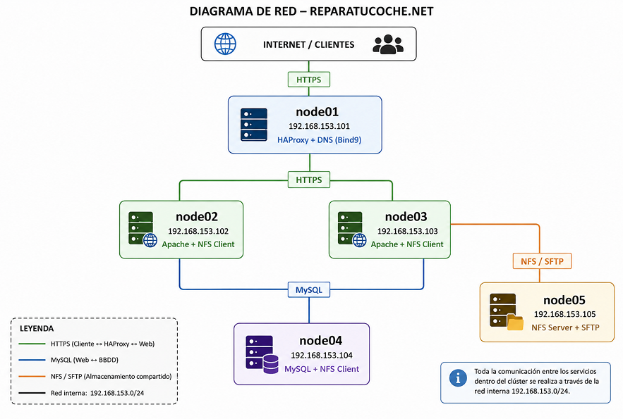<br>


Para la **red** he usado una red privada para la comunicacion entre los servidores, basada en el rango 192.168.153.0/24.<br>

| Servidor | Direccion IP | Funcion |
|----------|--------------|---------|
| node01 | 192.168.153.101 | HAProxy + DNS |
| node02 | 192.168.153.102 | WEB1 + NFS Client |
| node03 | 192.168.153.103 | WEB2 + NFS Client |
| node04 | 192.168.153.104 | MySQL + NFS Client |
| node05 | 192.168.153.105 | NFS Server + SFTP |
<br>

**NOTA:** En este proyecto la division de los servicios en estos servidores es por la falta de recursos fisicos. Lo ideal es separar cada funcion en un servidor, teniendo un servidor independiente para DNS, otro para HAProxy, dos servidores NFS para tener redundacia y asegurar alta disponibilidad, otro servidor BBDD para backups, y otro servidor independiente para SFTP.<br>

## 4.- Balanceador de cargas
Instalo y configuro **HAProxy** en **node01**. Ademas de crear certificados autofirmados y parametros Diffie-Hellman para la seguridad HTTPS.<br>

### 4.1.- Instalacion
Instalo HAPorxy:<br>
```bash
apt install haproxy
```
<br>

Habilito para que el servicio arraque automaticamente:<br>
```bash
systemctl enable haproxy
```
<br>

Compruebo que el servicio este funcionando:<br>
```bash
systemctl status haproxy
```
<br>

### 4.2.- Configuracion
El archivo de configuracio de HAProxy se encuentra en `/etc/haproxy/haproxy.cfg`.<br>

La seccion `global` tiene parametros relacionados con el funcionamiento general del servicio. El parametro `log /dev/log` indica donde se registran los eventos. El parametro `daemon` indica que el servicio funciona en segundo plano.<br>
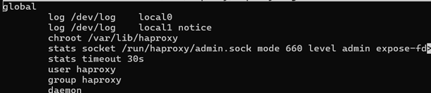
<br>

Para que funcione **HTTPS** en HAProxy es necesario que los certificados esten en un archivo `.pem`.<br>

Creo el directorio que contiene los certificados:<br>
```bash
mkdir -p /etc/ssl/reparatucoche
```
<br>

Creo los certificados autofirmados:<br>
```bash
openssl req -x509 -nodes -days 365 -newkey rsa:2048 -keyout /etc/ssl/reparatucoche/reparatucoche.key -out /eyc/reparatucoche/reparatucoche.crt
```
<br>

Creo el archivo `.pem`:<br>
```
bash -c 'cat /etc/ssl/reparatucoche/reparatucoche.crt /etc/ssl/reparatucoche/reparatucoche.key > /etc/ssl/reparatucoche/reparatucoche.pem'
```
<br>

Creo los parametros **Diffie-Hellman** para mejorar la seguridad HTTPS:<br>
```bash
openssl dhparam -out /etc/ssl/reparatucoche/dhparam.pem
```
<br>

La seccion `frontend` es donde se configura el punto de entrada por el que los usuarios realizan la conexion. El frontend lo voy a llamar `http_front` y a configurar:<br>
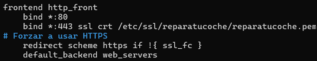
<br>

| Parametro | Funcion |
|-----------|---------|
| `bind *:80` | Indica que esucha las conexiones **HTTP** en el puerto 80 |
| `bind *:443` | Indica que esucha las conexiones **HTTPS** en el puerto 443 |
| `ssl crt` | Activa el cifrado SSL/TLS e indica la ruta del archivo de certificados |
| `redirect sheme https if !{ ssl_fc }` | Fuerza a los usuarios a usar HTTPS |
| `default_backend` | Indica el backend al que enviara todas las petiociones |

<br>

La seccion `backend` define los servidores que procesaran las peticiones. El backend lo voy a llamar `web_servers` y a configurar:<br>
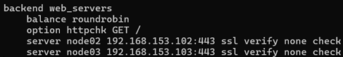
<br>

| Parametro | Funcion |
|-----------|---------|
| `balance roundrobin` | Define el algoritmo de balanceo, roundrobin es un algoritmo que distribuye las peticiones de forma alterna |
| `option httpchk GET /` | Activa los **Health checks** automaticos *(Envia una peticion GET a cada servidor)* |
| `server *servidor* *IP*` | Define los servidores | 
| `ssl verify none check` | **ssl** obliga a conectarse con HTTPS, **verify none** acepta certificados autofirmados y **check** activa los health checks para el servidor |

**NOTA:** En entornos mas grandes con mas servidores y trafico de usuarios, en vez de usar el algoritmo **roundrobin** recomiendo usar **leastconn**. Este algoritmo distribuye a los usuarios hacia el servidor con menos conexiones activas.

Para terminar la configuracion de HAProxy agrego los parametros **Diffie-Hellman** en la seccion `global`:<br>

<br>

### 4.3.- Comprobar el funcionamiento
Para comprobar el funcionamiento del servicio, comprobamos los logs:<br>
```bash
tail -f /var/log/haproxy.log
```
<br>

Y se puede monitorizar el servicio:<br>
```bash
journalctl -u haproxy -f
```
<br>

## 5.- DNS
Instalo y configuro el **DNS** en **node01**. El dominio que va a resolver es **ReaparaTuCoche.net**. El archivo de configuracon del servicio es `/etc/bind/db.reparatucoche.net`.

### 5.1- Instalacion
Instalo **Bind9**:<br>
```bash
apt install bind9 bind9utils bin9-doc
```
<br>

Habilito el servicio para que arranque automaticamente:<br>
```bash
systemctl enable bind9
```
<br>

Compruebo que funciona:<br>
```bash
systemctl status bind9
```
<br>

### 5.2- Configuracion
Para la configuracion del servicio **DNS**, voy a crear el archivo desde la plantilla que trae el ervicio:<br>
```bash
cp /etc/bind/db.local /etc/bind/db.reparatucoche.net
```
<br>

En el archivo de configuracion se aniaden los registros DNS del dominio para resolver a las peticiones del cliente, admeas de los demas servidores del cluster para acceder a ellos sin necesidad de usar direccion IP:<br>
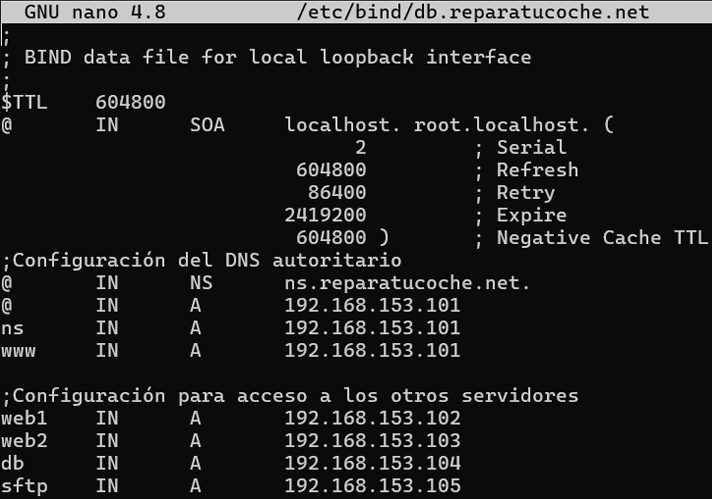
<br>

| Parametro | Funcion |
|-----------|---------|
| `$TTL` | Define el tiempo que los registros permaneceran en cache |
| `SOA` | Indica el servidor DNS principal, correo del administrador, version de zona y tiempos de sincronizacion |
| `NS` | Define el servidor autoritativo de la zona |
| `A`| Relaciona un nombre con una IP |

<br>

Confiduro el archivo `/etc/bind/named.conf.local`, ahi defino la zona DNS del servidor:<br>
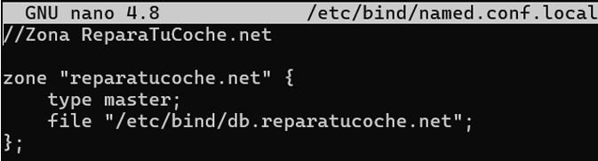
<br>

| Parametro | Funcion |
|-----------|---------|
| `zone` | Indica el nombre de la zona |
| `type master` | Indica que la zona es de tipo maestro |
| `file` | Indica la ruta del archivo de configuracion de la zona |

<br>

Compruebo la sintaxis de los archivos:<br>
```bash
named-checkconf
```
```bash
named-checkzone reparatucoche.net /etc/bind/db.reparatucoche.net
```
<br>

Reinico el servicio:<br>
```bash
systemctl restart bind9
```
<br>

Tras configurar en **node01** el DNS, ahora configuro en todos los servidores **(node02, node03, node04 y node05)** el archivo de red `/etc/netplan/00-installer.config.yaml` la opcion de `nameservers` y aniado la IP del servidor DNS:<br>
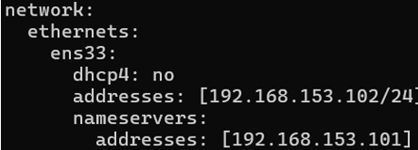
<br>

Aplico la configuracion de red:<br>
```bash
netplan apply
```
<br>

### 5.3.- Comprobar el funcionamiento
Compruebo la resolucion del nombre de dominio:<br>
```bash
nslookup reparatucoche.net
```
<br>

Y tambien monitorizo el bind9 para visualizar los eventos en tiempo real:<br>
```bash
journalctl -u bind9 -f
```
<br>

## 6.- SFTP
Voy a configurar **SFTP** en **node05** con el objetivo de pasar de mi maquina a las maquinas virtuales los archivos de la pagina web y la estructura de la BBDD. La eleccion de este servidor es porque tambien tendra **NSF** y compartira los archivos desde una carpeta compartida.<br>

### 6.1.- Instalacion
Ya que **SFTP** funciona sobre **SSH**, voy a instalar **OpenSSH**:<br>
```bash
apt install openssh-server
```
<br>

### 6.2.- Configuracion
Primero voy a crear un usuario para las conexiones SFTP:<br>
```bash
adduser sftpuser
```
<br>

El usuario **sftpuser** quiero que este enjaulado, de esta forma no puede acceder a ninguna carpeta o archivo fuera de la acrpeta asignada. Esta decision es con el onjetivo de proteger los sistemas y servidores en caso de estar comprometidas las credenciales del usuario.<br>

Creo el directorio donde voy a enjaular al usuario:<br>
```bash
mkdir -p /srv/sftp
```
<br>

Para poder enjaular al usuario la carpeta debe pertenecer al usuario **root** y tener permisos 755. Para ello hare:<br>
```bash
chown root:root /srv/sftp
```
```bash
chmod 755 /srv/sftp
```
<br>

Configuro el archivo del servicio, `/etc/ssh/sshd_config`. Para ello lo primero es descomentar la linea:<br>
```bash
Subsystem   sftp    /usr/lib/openssh/sftp-server
```
<br>

Al final del archivo configuro la jaula del usuario:<br>
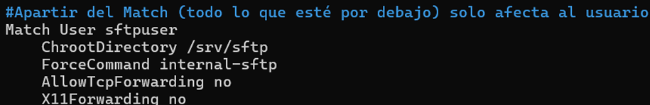
<br>

| Parametro | Funcion |
|-----------|---------|
| `Mach User` | Indica el usuario al que se le aplican las reglas |
| `ChrootDirectory` | Indica la ruta del directorio donde se enjaula al usuario |
| `ForceCommand internal-sftp` | Obliga al usuario a usar SFTP |
| `AllowTcpForwarding no` | Impide redireccion de puertos |
| `X11Forwarding no` | Evita conexiones graficas` |

<br>

Compruebo la configuracion del archivo de configuracion:<br>
```bash
sshd -t
```
<br>

Reinicio el servicio:<br>
```bash
systemctl restart ssh
```
<br>

### 6.3.- Comprobar el funcionamiento
Para comprobar el funcionamiento, accedo desde mi maquina (windows) al servidor usando **FileZilla**:<br>
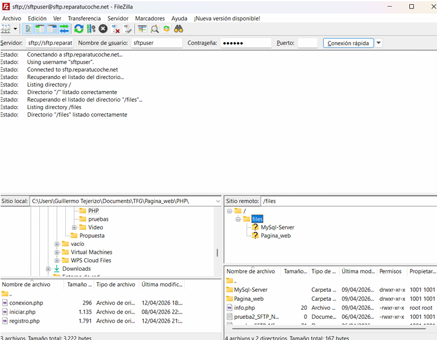
<br>

Y tambien monitorizo el servicio comprobando las conexiones y trasnferencias de datos:<br>
```bash
tail -f /var/log/auth.log
```
```bash
ps aux | grep sftp
```
<br>

## 7.- NFS
Con **NFS** quiero que el contenido de la pagina web este sincronizado, compartiendo a traves de una acrpeta compartida los archivos con los servidores web. Ademas para poder actualizar de forma facil y sencilla los archivos, sera la misma carpeta que para **SFTP** y por eso el servicio esta en **node05**.

### 7.1.- Instalacion
Instalo **NFS Server** en **node05**:<br>
```bash
apt install nfs-kernel-server
```
<br>

Instalo **NFS Client** en los servidores web y el de BBDD:<br>
```bash
apt install nfs-common
```
<br>

### 7.2.- Configuracion
Primero creo la carpeta de **node05** desde la que voy a compartir los archivos:<br>
```bash
mkdir -p /srv/sftp/files
```

La configuracion de **NFS** se hace en el archivo **/etc/exports**, donde aniado al final del archivo la configuracion para que comparta el directorio en los servidores web y BBDD:<br>
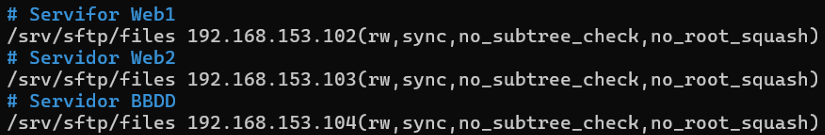
<br>

| Parametro | Funcion |
|-----------|---------|
| `/srv/sftp/files` | Carpeta local que comparte con los servidores clientes |
| `rw` | Da permisos de lectura y escritura |
| `sync` | Indica que el servidor escribe primero los cambios en el disco y despues responde al cliente |
| `no_subtree_check` | Desactiva las comprobaciones adicionales sobre subdirectorios (Motivo: evitar reducir el rendimiento) |
| `no_root_squash` | Permite al usuario root del cliente mantener los privilegios sobre el recurso NFS compartido |

**NOTA:** Permitir que el usuario root tenga permisos sobre el recurso NFS es peligroso en casos externos al laboratorio. Esta decision se ha tomado por comodidad y simplicidad de la configuracion. Para mejorar la seguridad es mejor opcion usar `root_squash`.<br>

Tras configurar el servicio, aplico los cambios del archivo:<br>
```bash
exportfs -a
```
<br>

Ahora que la parte servidor del **NFS** esta configurada, me encargo de configurar los servidores con **NFS Client**. Lo primero es crear la carpeta donde montare el recurso:<br>
```bash
mkdir -p /var/www/shared
```
<br>

Edito el archivo de configuracion **/etc/fstab**, donde añiado al final del archivo el directorio donde mostrara los recursos compartidos:<br>
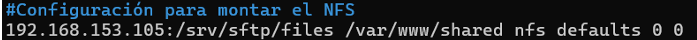
<br>

| Parametro | Funcion |
|-----------|---------|
| `192.168.153.105` | Indica la IP de la parte servidor |
| `:/srv/sftp/files` | Indica la carpeta de la parte del servidor que se comparte |
| `/var/www/shared` | Indica la carpeta local donde se realiza el punto de montaje |
| `nfs` | Indica el sistema de archivos utilizado |
| `defaults` | Indica que la opcion de montaje es estandar |
| `0 0` | El primer valor es el **Dump** e indica si el sistema debe realizar copias de seguridad (0 = no), y el segundo valor es el **Pass** e indica el orden en el que Linux comprobara los sistemas de archivos durante el arranque (0 = no comprueba) |

<br>

Tras configurara el archivo, monto el recurso compartido<br>
```bash
mount -a
```
<br>

### 7.3.- Comprobar el funcionamiento
En **node05** se puede comprobar las exportaciones activas con:<br>
```bash
exportfs -v
```
<br>

O el funcionamiento del servicio con:<br>
```bash
systemctl status nfs-kernel-server
```
<br>

En los servidores clientes podemos comprobar el funcionamiento viendo las carpetas compartidas con:<br>
```bash
showmount -e 192.168.153.105
```
```bash
mount | grep nfs
```
<br>

## 8.- Base de Datos y MySQL
El objetivo de la Base de Datos es guardar la informacion de los usuarios para poder gestionar el sistema de autenticacion de los mismos a traves de PHP.<br>

### 8.1.- Instalacion
La BBDD va a estar en **node04** y va a usar **MySQL**. Asi que lo primero que hago es:<br>
```bash
apt install mysql-server
```
<br>

Y despues compruebo que funciona correctamente:<br>
```bash
systemctl status mysql
```
<br>

Tras la comprobacion, habilito el servicio con el arranque del sistema:<br>
```bash
systemctl enable mysql
```
<br>

### 8.2.- Configuracion
Para hacer una configuracion segura he usado el asistente de configuracion:<br>
```bash
mysql_secure_installation
```
<br>

Una vez acabado lo anterior, accedo a **MySQL** y creo la BBDD:<br>
```SQL
CREATE DATABASE usuarios_db;
```
<br>

Ahora voy a crear dos usuarios: uno propio para trabajar y el usuario por el que accederan los servidores web para hacer consultas (webuser):<br>
```SQL
CREATE USER 'webuser'@'192.168.153.%' IDENTIFIED BY 'PIN';
```
<br>

Al usuario **webuser** le dare todos los privilegios en la BBDD y que pueda acceder desde cualquier dispositivos de la red:<br>
```SQL
GRANT ALL PRIVILEGES ON usuarios_db.*TO 'webuser'@'192.168.153.%';
```
<br>

Actualizo la tabla de permisos para aplicar los cambios:<br>
```SQL
FLUSH PRIVILEGES;
```
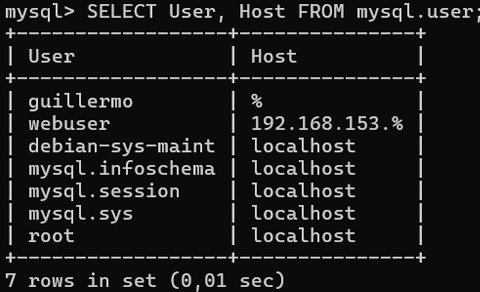
<br>

El archivo de configuracion de **MySQL** es **/etc/mysql/mysql.conf.d/mysqld.cnf**, donde modifico `bind-address` para que la IP se **0.0.0.0** y esuches conexiones desde cualquier red.<br>

Tras configurar el archivo, permito el trafico por el puerto **3306**:<br>
```bash
ufw allow 3306/tcp
```
<br>

Y reinicio el servicio:<br>
```bash
systemctl restart mysql
```
<br>

Una vez configurado MySQL y creada la BBDD, voy a insertar el contenido de la BBDD desde un archivo de la carpeta compartida:<br>
```bash
mysql -u guillermo -p < /var/www/shared/MySql-Server/BBDD/usuarios_db.sql
```
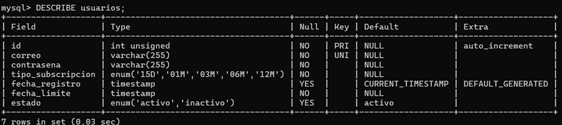
<br>

### 8.3.- Base de Datos
La base de datos gestiona el sistema de registro, autenticacion y control de suscripciones. La base de datos se compone de una unica tabla, **usuarios**, donde se almacena la informacion necesaria del login.<br>

```SQL
CREATE DATABASE IF NOT EXISTS usuarios_db; -- 'IF NOT EXISTS' ASEGURA Q SI EXISTE LA BBDD no haga nada y no de error
USE usuarios_db; -- 'USE' indica q entramos en la BBDD, asi se puede trabajar en ella -> para saber la BBDD en la q estas usa 'SELECT DATABASE();'

CREATE TABLE usuarios (
    -- COLUMNAS
    id INT UNSIGNED NOT NULL AUTO_INCREMENT,
    -- UNSIGNDE indica que el valor no puede ser negativo
    -- INT indica que el valor deben d ser numeros enteros
    -- ZEROFILL aniade 0 a la izquierda ()
    -- AUTO_INCREMENT aumenta el numero de la fila
    correo VARCHAR(255) NOT NULL UNIQUE,
    contrasena VARCHAR(255) NOT NULL,
    tipo_subscripcion ENUM('15D', '01M', '03M', '06M', '12M') NOT NULL,
    fecha_registro TIMESTAMP DEFAULT CURRENT_TIMESTAMP,
    fecha_limite TIMESTAMP NOT NULL,
    estado ENUM('activo', 'inactivo') DEFAULT 'activo',
    
    -- CONDICIONES
    PRIMARY KEY (id) -- Indica la clave primaria
    -- CHECK (id BETWEEN 1 AND 9999) -- Comprueba q se cumpla el requisito de estar entre los numeros 0001 y 9999
); -- AUTO_INCREMENT=1;
```

| Campo | Funcion |
|-------|---------|
| `id` | Identificador unico de usuario |
| `correo` | Correo electronico del usuario, es unico |
| `contrasena` | Contrasenia del usuario, esta cifrada |
| `tipo_suscripcion` | Tipo de suscripcion del usuario |
| `Fecha_registro` | Almacena automaticamente la fecha y hora de cuando se registro el usuario |
| `fecha_limite` | Almacena cuando finaliza la suscripcion, se obtiene de un calculo con PHP |
| `estado` | Indica si la cuenta esta habilitada |

<br>

### 8.4.- Comprobar el funcionamiento
Compruebo que el puerto **3306** este escuchando:<br>
```bash
ss -tulnp | grep 3306
```
<br>

## 9.- Apache
El servicio de **Apache** se encuentra en los servidores web, **nod02** y **node03**, y la pagina web la obtiene de la carpeta compartida con NFS.

### 9.1.- Instalacion
Instalo **Apache2**:<br>
```bash
apt install apache2
```
<br>

Despues, habilito el arranque automatico:<br>
```bash
systemctl enable apache2
```
<br>

### 9.2.- Configuracion
Para la comunicacion entre servidores se usa **HTTPS**, tengo que habilitar un modulo **SSL** para el cifrado:<br>
```bash
a2enmod ssl
```
<br>

Y despues, habilito la configuracion **HTTPS**:<br>
```bash
a2ensite default-ssl.conf
```
<br>

Para los certificados autofirmados, primero creo el directorio donde los voy a almacenar:<br>
```bash
mkdir -p /etc/apache2/ssl
```
<br>

Ahora creo los certificados autofirmados con **OpenSSL**:<br>
```bash
openssl req -x589 -nodes -days 365 -newkey rsa:1048 -keyout /etc/apache2/ssl/apache.key -out /etc/apache2/ssl/apache.crt
```
<br>

Tras crear los certificados autofirmados, modifico el archivo de configuracion **/etc/apache2/sites-available/default-ssl.conf**, donde especifico en `DocumentRoot` la ruta de la pagina (en la carpeta compartida), en `SSLCerticateFile` el archivo **.crt** y en `SSLCertificateKeyFile` el archivo **.key**:<br>
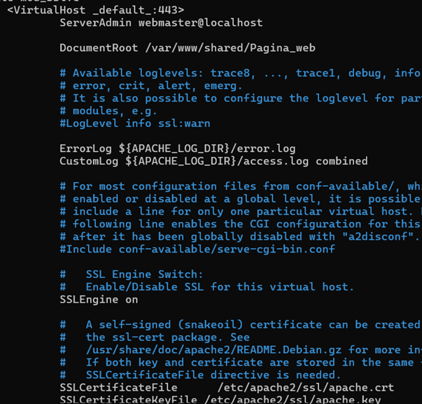
<br>

Una vez configurado reinicio Apache:<br>
```bash
systemctl restart apache2
```
<br>

Y permito el ttrafico por el puerto 443:<br>
```bash
ufw allow 443/tcp
```
<br>

### 9.3.- Comprobar el funcionamiento
Compruebo que escucha por el puerto 443:<br>
```bash
ss -tulnp | grep 443
```
<br>

Para ver si hay errores en Apache uso:<br>
```bash
tail -f /var/log/apache2/error.log
```
<br>

Para poder monitorizar las peticiones recibidas puedo usar:<br>
```bash
tail -f /etc/log/apache2/access.log
```
<br>

## 10.- Pagina web
La pagina web tiene una estructura de division de carpetas segun su funcion y tipo de archivo, quedando una estructura:<br>
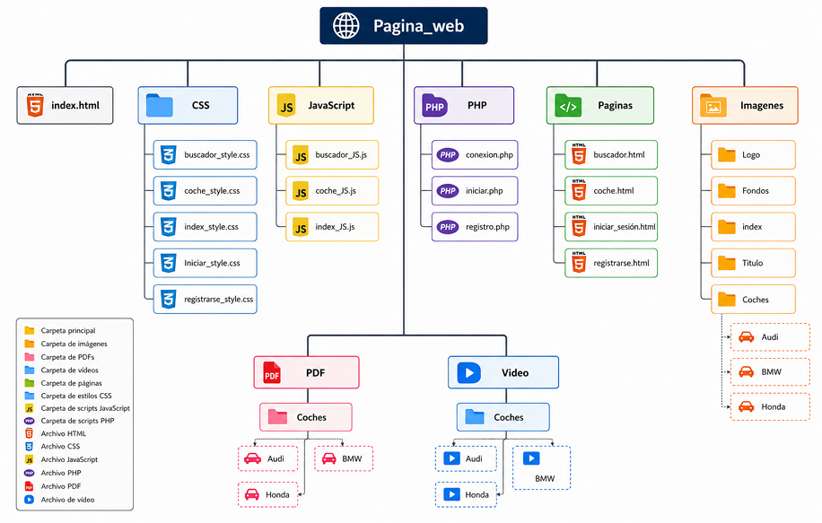
<br>

## 11.- PHP
Para hacer el sistema de login he usado **PHP** y he creado tres archivos donde cada uno se encarga de una funcion: **conexion.php**, **registro.php** e **iniciar.php**.<br>

### 11.1.- conexion.php
Este archivo es el encargado de establecer conexion con la BBDD. Es sencillo pero funcional, ya que simplemente guarda los datos de las credenciales del usuario y la informacion del servidor **node04** y la BBDD:<br>
```php
<?php
$host = "192.168.153.104"; // IP Servidor BBDD que es al nos queremos conectar
$user = "webuser";
$password = "897612";
$db = "usuarios_db";

$conn = new mysqli($host, $user, $password, $db);

if ($conn->connect_error) {
    die("Error de conexión: " . $conn->connect_error);
}
```
<br>

### 11.2.- registro.php
La funcion de este archivo es es gestionar el registro de nuevos usuarios.<br>
```php
<?php
ini_set('display_errors', 1);
error_reporting(E_ALL);

// Solo permitir acceso desde formulario
if ($_SERVER["REQUEST_METHOD"] !== "POST") {
    die("Acceso no válido");
}

include "conexion.php"; //Incluye el archivo conexion.php

// Recoger datos de forma segura
$correo = $_POST['correo'] ?? '';
$contrasena_raw = $_POST['contrasena'] ?? '';
$tipo = $_POST['suscripcion'] ?? '';

var_dump($_POST);

// Validar campos
if (empty($correo)) die("Falta correo");
if (empty($contrasena_raw)) die("Falta contraseña");
if (empty($tipo)) die("Falta subscripción");

// Encriptar contrasenia
$contrasena = password_hash($contrasena_raw, PASSWORD_DEFAULT);

// Normalizar tipo de suscripcion (por si acaso)
switch ($tipo) {
    case "15D": $dias = "+15 days"; break;
    case "01M": $dias = "+1 month"; break;
    case "03M": $dias = "+3 months"; break;
    case "06M": $dias = "+6 months"; break;
    case "12M": $dias = "+12 months"; break;
    default:
        die("Tipo de suscripción no válido");
}

// Calcular fecha de expiracion
$fecha = new DateTime();
$fecha->modify($dias);
$fecha_limite = $fecha->format('Y-m-d H:i:s');

// Preparar SQL
$sql = "INSERT INTO usuarios (correo, contrasena, tipo_subscripcion, fecha_limite)
        VALUES (?, ?, ?, ?)";

$stmt = $conn->prepare($sql);

// Comprobar error en prepare
if (!$stmt) {
    die("Error en SQL: " . $conn->error);
}

$stmt->bind_param("ssss", $correo, $contrasena, $tipo, $fecha_limite);

// Ejecutar
if ($stmt->execute()) {
    header("Location: ../Paginas/iniciar_sesión.html");
    exit;
} else {
    if ($conn->errno == 1062) {
        echo "El correo ya está registrado";
    } else {
        echo "Error al registrar: " . $stmt->error;
    }
}
```
<br>

### 11.3.- Iniciar.php
Y este ultimo archivo es el encargado de hacer que los usuarios puedan iniciar sesion:<br>
```php
<?php
// Crear sesion para mantener identificado al usuario mientras navega por la web. HTTP es un usuario que olvida a los usuarios al cambiar de pagina
session_start();
include "conexion.php";

// Obtener las credenciales del usuario
$correo = $_POST['correo'];
$contrasena = $_POST['contrasena'];

// Buscar al usuario en la BBDD
$sql = "SELECT * FROM usuarios WHERE correo = ?";
$stmt = $conn->prepare($sql);
$stmt->bind_param("s", $correo);
$stmt->execute();

$result = $stmt->get_result();

if ($result->num_rows === 1) {
    $user = $result->fetch_assoc();

    // Verificar contrasenia
    if (password_verify($contrasena, $user['contrasena'])) {

        // Verificar expiracion
        $now = new DateTime();
        $exp = new DateTime($user['fecha_expiracion']);

        // Comprobar el estado de la cuenta
        if ($now > $exp) { // Si el estado de la cuenta es Expirado -> actualizar estado
            $conn->query("UPDATE usuarios SET estado='inactivo' WHERE id=" . $user['id']);
            echo "Cuenta expirada";
            exit;
        }
        if ($user['estado'] === 'activo') { // Si el esatdo de la cuenta es activo -> Iniciar sesion
            $_SESSION['usuario'] = $correo;
            header("Location: ../Paginas/buscador.html");
        } else { // Si no es activo -> avisar
            echo "Cuenta inactiva";
        }
    } else {
        echo "Contraseña incorrecta";
    }
} else { // Respuesta en caso de que no se encuentre al usuario
    echo "Usuario no existe";
}
```
<br>

## 12.- Conclusiones
Este es mi primer proyecto grande y la verdad que he disfrutado bastante el tiempo mientras lo hacia. Este documento lo he realizado meses despues de presentarlo ante tribunal. Mientras lo preparaba para subir a GitHub he visto algunas cosas que me gustaria aniadir, como permitir que los usuarios puedan renovar la cuenta, una pagina que simule que la parte de la compra de una suscripcion, una seccion donde se puedan dejar comentarios, sistema de Backup aunque sea en el mismo servidor, etc.<br>
Lamentablemente ahora ya no dispongo de las maquinas virtuales y estoy ocupado con otros proyectos para rehacerlo y mejorarlo, pero al final este el proyecto es el final de una etapa de formacion y el principio de otra y estoy orgulloso de haberlo realizado, ya que he aprendido bastante con el.<br>
Espero que le sirva de ejemplo o guia a alguien que quiera hacer un TFC o simplemente aprender algo nuevo.
